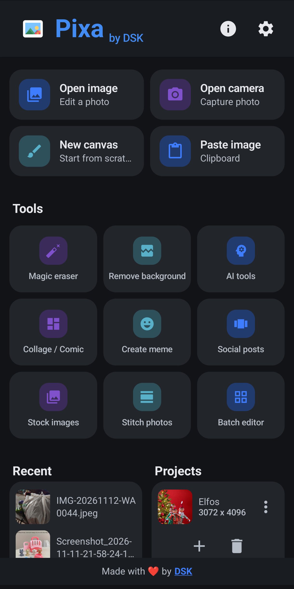
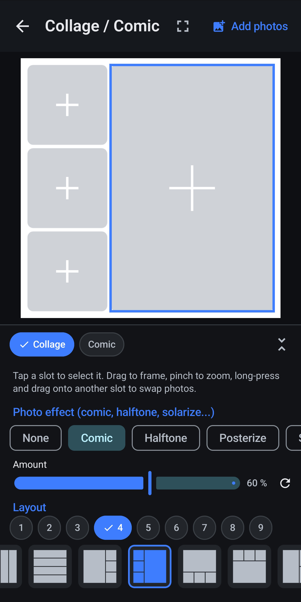
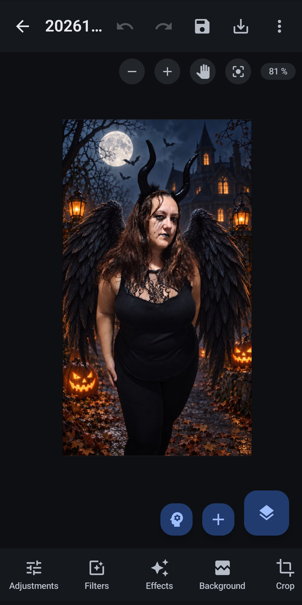
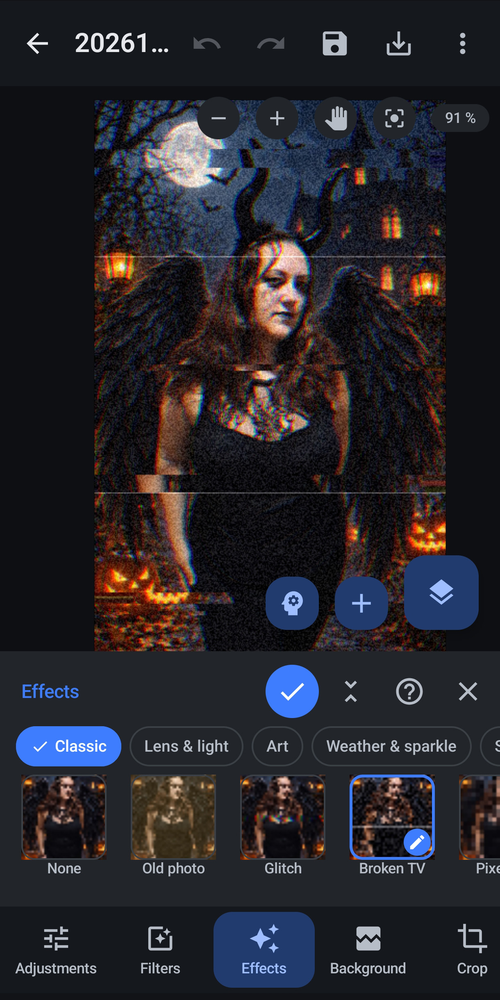

<div align="center">

# 🎨 Pixa by DSK

### Your whole photo studio, in your pocket.

**Layers, selections, text, drawing, retouching, on-device AI, comics, collages, memes and fake social posts.**
**No ads. No accounts. No trackers.**

[🇬🇧 English](README.md) · [🇪🇸 Español](README.es.md)

<br>


[](LICENSE)


**[⬇️ Download the latest APK](https://github.com/dskmusic/Pixa/releases/latest/download/Pixa.apk)** · **[🌐 pixa.dskmusic.com](https://pixa.dskmusic.com)**

</div>

---

<p align="center">
  
  
  
  
</p>

## ✨ What is Pixa?

**Pixa by DSK** is a native Android image editor for people who want to **do everything without leaving one app**:
retouch a photo, cut out the background, build a comic with speech bubbles that point at faces, make a meme,
put together a collage, stitch screenshots or process fifty photos in one go.

- ⚡ **Fast and fluid**: gestures preview at lower resolution and snap back to full quality when you let go.
- 🧩 **Everything stays editable**: text, shapes, QR codes, gradients and bubbles are layers you can reopen any time.
- 🔒 **Private**: AI runs on your device. No ads, no accounts, no analytics.
- 🌍 **Your language**: English and Spanish.

## 📊 Pixa in numbers

| 🔤 Text styles | 🖼️ Filters | ✨ Effects | 🧱 Collage layouts | 🤖 Background-removal methods | 📱 Social platforms |
|:-:|:-:|:-:|:-:|:-:|:-:|
| **100** | **80** | **50** | **120** | **9** | **12** |

Plus 30 layer styles, 20 frames, 20 text textures, 16 blend modes, 12 meme templates and 6 gradient types.

## 🧰 Highlights

| | |
|---|---|
| **🗂️ Layers** | Image, text, shape, QR, emoji, gradient, solid colour and speech-bubble layers; 16 blend modes, clipping masks, groups, layer styles (shadow, glow, outline) and rasterize. |
| **🎯 Selection** | Rectangle, ellipse, free and polygonal lasso, **magnetic lasso**, magic wand and colour select; add / subtract / intersect, feather and duplicate to a new layer. |
| **🎨 Colour & looks** | Curves, levels with histogram, per-colour HSL, 80 filters, importable `.cube` LUTs, 50 effects with live preview and a before/after curtain. |
| **🔤 Text** | Google Fonts plus your own, 100 one-tap styles, 20 generated textures, image inside letters, curved text and text on a path. |
| **🖌️ Draw & retouch** | Brush, pencil, airbrush, symmetry modes, clone stamp, blur/sharpen brushes, red-eye, and automatic face blur for privacy. |
| **🧠 On-device AI** | Background removal (9 models), tap-to-select, object removal, ×4 upscale, denoise, face restore, colourise, portrait blur, OCR and document scanner. |
| **🦸 Creators** | Collage & comic maker, memes, fake social posts (X, Instagram, TikTok, WhatsApp…), photo stitching and a background batch editor. |
| **🛟 Safety net** | Autosave and crash recovery, 30-day trash, saved versions, backups and a full step history. |
| **📤 Export** | PNG, JPEG, WEBP and PDF, target file size, EXIF control, selection or layer only, direct printing. |

## 🧠 On-device AI

Models are downloaded **once, on demand**, run locally with ONNX Runtime, and can be deleted to free space.
Before each task Pixa tells you how much it will download and how long it should take.

| Feature | Model | Size |
|---|---|---|
| Upscale / enhance detail | Swin2SR lite | 8 MB |
| Denoise | SCUNet | 77 MB |
| Tap to select | MobileSAM | 45 MB |
| Portrait blur / depth fog | Depth Anything V2 Small | 27 MB |
| Colourise | DDColor tiny | 135 MB |
| Remove objects | MI-GAN | 28 MB |
| Restore faces | GFPGAN 1.4 | 340 MB |
| Remove background | ML Kit, MediaPipe, U2-Net, ISNet, MODNet, RMBG 1.4… | varies |

Download URLs live in [`ml/src/main/assets/ai_models.json`](ml/src/main/assets) and can point to your own mirror.

## 🚀 Build and run

**Requirements:** a recent Android Studio, **JDK 17** (the bundled one works) and the **Android SDK 35**. Android 10+ device.

```bash
git clone https://github.com/dskmusic/Pixa.git
cd Pixa
```

1. Open the **root** folder (the one with `settings.gradle.kts`) in Android Studio.
2. *(Optional)* copy [`local.properties.example`](local.properties.example) to `local.properties` and add your API keys (below).
3. Press **Run ▶**.

```bash
./gradlew :app:assembleDebug     # debug APK (installs as com.dskmusic.pixa.debug)
./gradlew :app:assembleRelease   # release APK (R8 + resource shrinking)
```

### 🔑 API keys (optional)

Three online features need a free key. Without it, the app builds and runs normally and that feature is simply disabled.
Put the key in `local.properties` (never committed) **or** in an environment variable:

| Feature | `local.properties` | Environment variable | Get it |
|---|---|---|---|
| Stock images | `pixabay.apiKey` | `PIXA_API_PIXABAY` | [pixabay.com/api/docs](https://pixabay.com/api/docs/) |
| Stickers | `klipy.apiKey` | `PIXA_API_KLIPY` | [klipy.com/developers](https://klipy.com/developers) |
| Full Google Fonts list | `googleFonts.apiKey` | `PIXA_API_GOOGLEFONTS` | [Google Cloud Console](https://console.cloud.google.com/apis/credentials) (Web Fonts Developer API) |

> ⚠️ Keys end up inside the compiled APK. Releases published here are built **without** keys.

### 🤖 Releases via GitHub Actions

*Actions → Build release APK → Run workflow* builds a signed APK and publishes it as `Pixa.apk`.
The version comes from [`version.properties`](version.properties) or the form. It needs the repository secrets
`KEYSTORE_BASE64`, `KEYSTORE_PASSWORD`, `KEY_ALIAS` and `KEY_PASSWORD`.

## 🏗️ Under the hood

Kotlin · Jetpack Compose (Material 3) · MVVM with coroutines and `Flow` · DataStore · WorkManager · Glance widget ·
ONNX Runtime · ML Kit · ZXing core · Coil. **One single drawing implementation**: the on-screen preview and the final export
call the same `android.graphics` code, so what you see is exactly what you export. Filters, blurs, gradients, curved text,
frames and PDF export are written from scratch with `android.graphics` and AGSL, with no third-party image libraries.

Architecture and project structure (Spanish): [`docs/ARQUITECTURA.md`](docs/ARQUITECTURA.md).

## 🔒 Privacy

The only permission is `POST_NOTIFICATIONS` (batch progress). No camera or storage permissions: it uses the system photo picker and
the Storage Access Framework. The network is used only for Google Fonts, optional AI-model downloads and the stock/sticker search you start.

## 📄 License

[Apache License 2.0](LICENSE). If you redistribute Pixa or a fork, keep the [`NOTICE`](NOTICE) and credit
**"Pixa by DSK"** with a link to <https://www.dskmusic.com/dsk_dev_redirect.php>.

<div align="center">

Made with ❤️ by [DSK](https://www.dskmusic.com/dsk_dev_redirect.php)

</div>
